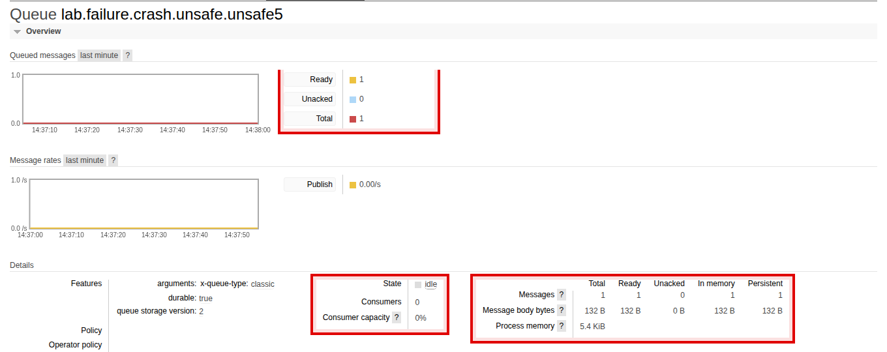
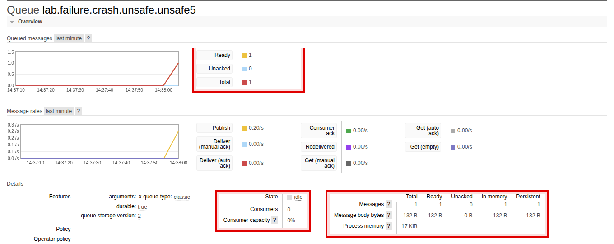
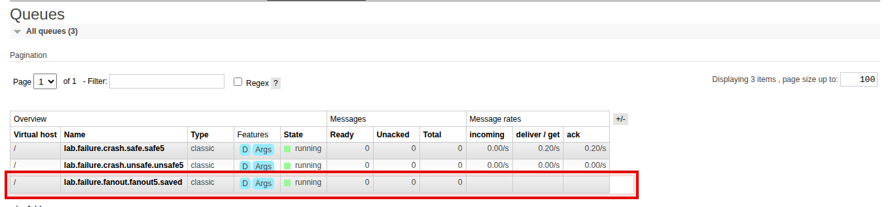
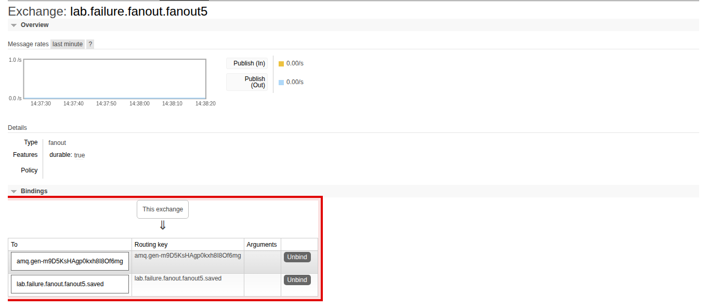
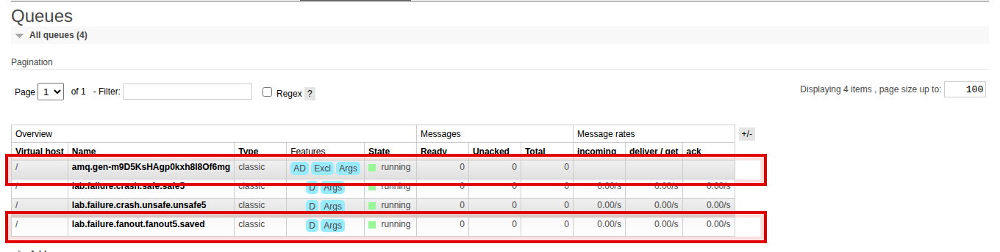
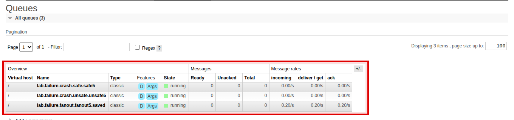
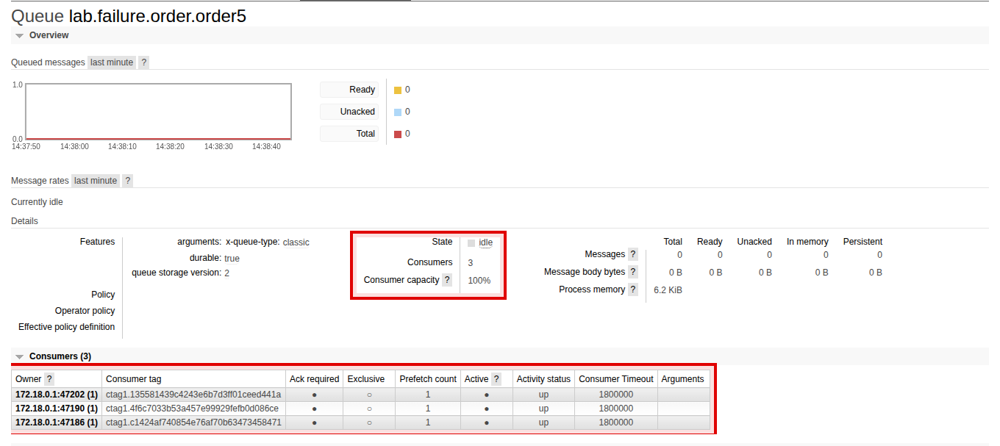
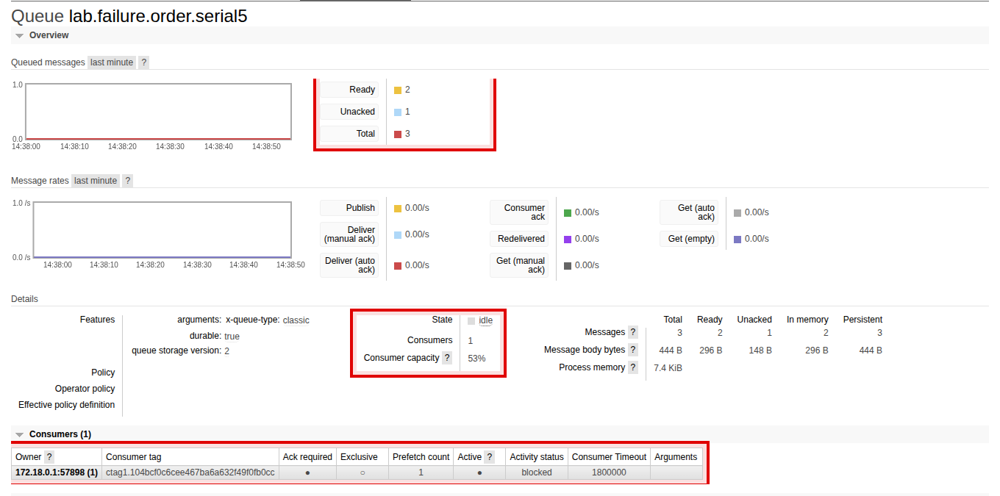

# Message Queue Lab Report — Six Exercises on RabbitMQ and Kafka

<strong>2110521 Software Architecture — Individual Assignment 4</strong> 
Student: <strong>Watayut Aiamanan</strong> · Student ID: <strong>6970267821</strong> · Submitted: 13 October 2026 
Brokers: RabbitMQ 4.3.6 (management UI) and Apache Kafka 4.1.2 (KRaft) from the lab <code>compose.yaml</code>, both <code>healthy</code> · Clients: Python 3.13, pika 1.3.2, confluent-kafka 2.11.1 · Evidence: terminal captures, RabbitMQ management-UI screenshots (Playwright), Kafka JSONL logs in <code>evidence/</code>

## Exercise 1 — RabbitMQ: Crash Before ACK {.first}

**Scenario.** A worker consumes one message, commits a row to SQLite, and then dies with `os._exit(99)` *before* sending `basic_ack`. The worker is then restarted without publishing again. The experiment is run in *unsafe* mode (no deduplication) and in *safe* mode (an `INSERT OR IGNORE` dedupe marker in the same transaction as the business effect).

### Unsafe mode — terminal output

### Safe mode — terminal output

### RabbitMQ management UI

The management-UI screenshots are cropped to the relevant part of the page and the values that matter are outlined in red.

### Results

| Run | `redelivered` | `applied` | `business_effect_count` |
|---|---|---|---|
| Unsafe — first run (crash) | False | `True` | `1` |
| Unsafe — restart | **True** | `True` | **`2`** ← duplicate |
| Safe — first run (crash) | False | `True` | `1` |
| Safe — restart | **True** | **`False`** | **`1`** ← deduplicated |

### Explanation

RabbitMQ delivers at-least-once: a message delivered to a consumer stays *unacknowledged* until the consumer sends `basic_ack`, and when that consumer's connection dies the broker puts the message back on the queue with the `redelivered` flag set, which is exactly what the UI screenshots show (Ready went 1 → 0 → 1 → 0). In unsafe mode the worker has no memory that it already handled event `ee756d9b…`, so the redelivery is treated as a brand-new order and a second row is inserted, giving `business_effect_count=2`. In safe mode the worker first executes `INSERT OR IGNORE INTO processed(event_id)`; on the redelivery the row already exists, `rowcount` is 0, the business insert is skipped and the count stays at 1, after which the worker ACKs so the message is finally removed. The single transaction is essential: because the dedupe marker and the business row are committed together, there is no window in which the effect is committed but the marker is not (or vice versa), so a crash at any point leaves the database either fully "done" or fully "not done". Using `os._exit(99)` rather than `sys.exit()` matters because `sys.exit` raises `SystemExit`, which would let pika's `finally` blocks close the channel gracefully, whereas `os._exit` kills the process instantly like a real crash and leaves the message unacknowledged.

---

## Exercise 2 — RabbitMQ: Late Subscribers

**Scenario.** A durable fanout exchange is created. `setup` declares and binds a durable queue *before* anything is published. The `BEFORE` message is published while no consumer is running. Then a durable consumer (attaching to the pre-existing queue) and a temporary consumer (declaring a new exclusive auto-delete queue and binding it *now*) are started, and `AFTER` is published.

### Terminal output

### RabbitMQ management UI

### Results

| Consumer | `BEFORE` | `AFTER` |
|---|---|---|
| Durable (`setup` ran first) | ✅ received at 14:38:28.618 (on start-up) | ✅ received at 14:38:35.281 |
| Temporary (bound after `BEFORE`) | ❌ never received | ✅ received at 14:38:35.280 |

### Explanation

A fanout exchange is a router, not a store: at the instant a message is published it is copied into every queue that is *currently* bound, and if nothing is bound the message is simply dropped. When `BEFORE` was published the only bound queue was the durable one, so the broker stored a copy there (Ready=1 in the screenshot) and the durable consumer received it the moment it attached, even though it had been offline during publication; buffering is a property of the queue, not of the exchange. The temporary queue did not exist yet, so there was nothing for the broker to copy `BEFORE` into, and when the exclusive queue was finally declared and bound it could only see traffic from that point on, which is why it got `AFTER` only. For the temporary consumer to receive `BEFORE`, its queue would have to be declared and bound before the publish happened, either by running it first or by making it a named, pre-declared queue like the durable one; nothing on the publisher side can fix this after the fact. Queue durability (the queue definition survives a broker restart) and message persistence (`delivery_mode=2`, the message is written to disk) are independent settings, and publishing to the exchange without ever running `setup` would deliver to zero queues with `mandatory=True` causing the publish to be returned as unroutable.

---

## Exercise 3 — RabbitMQ: Delivery vs. Completion Order

**Scenario.** Three tasks are published in order A (5 s), B (1 s), C (2 s) to a work queue. First three workers with `prefetch_count=1` consume concurrently; then the same three tasks are consumed by a single worker.

### Three-worker run — terminal output

### One-worker run — terminal output

### RabbitMQ management UI

### Results

| Workers | Delivery order | Completion order (from timestamps) | Elapsed from first START to last DONE |
|---|---|---|---|
| 3 (parallel) | A → B → C | **B (14:38:51.108) → C (14:38:52.109) → A (14:38:55.106)** | ≈ 5.0 s |
| 1 (sequential) | A → B → C | **A (14:39:01.359) → B (14:39:02.362) → C (14:39:04.366)** | ≈ 8.0 s |

### Explanation

RabbitMQ delivered A, B and C in the order they were published, but with three workers each task started at the same moment on a different process, so completion order was decided purely by task duration: B (1 s) finished first, C (2 s) second and A (5 s) last, and the whole batch took about 5 s, the length of the longest task. With `prefetch_count=1` the broker hands each worker at most one unacknowledged message at a time, which is what spread A, B and C across W3, W1 and W2 instead of letting the first worker grab all three; without it the first ready worker could have been sent all three messages and the others would have idled. `connection.sleep()` is used instead of `time.sleep()` so that pika keeps processing heartbeats and I/O during the simulated work; a plain sleep would block the client and could get the connection closed for missed heartbeats. The single-worker run guarantees A → B → C but costs the sum of all durations, about 8 s, because there is no concurrency at all. I would choose one worker (or, better, one worker *per ordering key*) only when the sequence of events genuinely matters, for example all events of the same order; for independent orders I would keep several workers and route each order's events to a single queue or partition so that different orders run concurrently while each order stays sequential.

---

## Exercise 4 — Kafka: Consumer Groups and Partitions

> **About the `%3|…|FAIL|… Connect to ipv6#[::1]:19092 failed` lines** in the Kafka captures: in this Codespace `localhost` resolves to the IPv6 address `::1` first, but Docker only publishes the broker port on IPv4 `127.0.0.1`. librdkafka logs the failed IPv6 attempt and then connects on IPv4 within the same millisecond, so the lines are cosmetic; every publish was confirmed and every consumer received its records. A consumer capture ending in `exited with code -2` was simply terminated by Ctrl+C after it had written its summary.

**Scenario.** A 4-partition topic receives 40 keyed records (10 per partition) and is consumed by groups of 2, 4 and 5 consumers using the `range` assignor with manual offset commits. Finally a brand-new group `lab.ex4.analytics2` replays the first topic.

### Partition assignment and records per consumer (from `evidence/ex4-*.jsonl`)

#### Group of 2 consumers — topic `lab.ex4.two2` (40 published: P0:10, P1:10, P2:10, P3:10; 40 consumed)

| Consumer | Assigned partitions | Records completed | Per partition | `unique_completed` |
|---|---|---|---|---|
| C1 | [0, 1] | 20 | P0:10, P1:10 | 20 |
| C2 | [2, 3] | 20 | P2:10, P3:10 | 20 |

#### Group of 4 consumers — topic `lab.ex4.four2` (40 published; 40 consumed)

| Consumer | Assigned partitions | Records completed | Per partition | `unique_completed` |
|---|---|---|---|---|
| C1 | [0] | 10 | P0:10 | 10 |
| C2 | [1] | 10 | P1:10 | 10 |
| C3 | [2] | 10 | P2:10 | 10 |
| C4 | [3] | 10 | P3:10 | 10 |

#### Group of 5 consumers — topic `lab.ex4.five2` (40 published; 40 consumed)

| Consumer | Assigned partitions | Records completed | Per partition | `unique_completed` |
|---|---|---|---|---|
| C1 | [0] | 10 | P0:10 | 10 |
| C2 | [1] | 10 | P1:10 | 10 |
| C3 | [2] | 10 | P2:10 | 10 |
| C4 | [3] | 10 | P3:10 | 10 |
| C5 | **[] (idle)** | **0** | – | 0 |

#### Analytics group replay — group `lab.ex4.analytics2` on `lab.ex4.two2`

| Consumer | Assigned partitions | Records completed | Per partition | Offsets read per partition |
|---|---|---|---|---|
| Analytics | [0, 1, 2, 3] | **40** | P0:10, P1:10, P2:10, P3:10 | 0–9 on every partition |

### Terminal output (JSONL evidence as printed by the consumers)

![Group of 2, C1: assigned [0, 1], then received/completed/committed for 20 records](terminal/png/ex4-two-C1.png)

![Group of 2, C2: assigned [2, 3], 20 records](terminal/png/ex4-two-C2.png)

![Group of 5, C1: assigned [0] and 10 records](terminal/png/ex4-five-C1.png)

![Group of 5, C5: assigned [] — it stays idle for the whole run and completes 0 records](terminal/png/ex4-five-C5.png)

### Explanation

In Kafka the partition, not the message, is the unit of parallelism inside a consumer group: each partition is owned by exactly one consumer of the group at a time, so with 4 partitions the group of 2 got 2 partitions (20 records) each, the group of 4 got 1 partition (10 records) each, and in the group of 5 the fifth consumer, C5, was assigned an empty list and processed nothing because there was no partition left to give it. C5 would only get work if another member left: in my first run of this experiment, where the consumers were stopped one at a time, partition 3 was reassigned to C5 the moment C1 left, which shows that a rebalance redistributes ownership whenever a member joins or leaves (in the clean run shown here all five were stopped together, so C5 stayed idle throughout). The analytics group could read all 40 records that `lab.ex4.two2` had already delivered because offsets are tracked *per group*, so a group that has never committed anything starts from `auto.offset.reset=earliest`, and the records are still there because Kafka retains the log (here for 24 h) regardless of who has consumed it. This is the key difference from RabbitMQ's competing-consumer model, where a message is removed from the queue once it is acknowledged and a late consumer can never see it; in Kafka consumption is a cursor over an immutable log, so adding independent readers is free. A consequence is that `auto.offset.reset` only matters the first time a group appears; re-running the analytics consumer with the same group id would resume from its committed offset 10 on each partition and receive nothing new.

---

## Exercise 5 — Kafka: Keyed Ordering

**Scenario.** Three events per order (Created → Updated → Cancelled, sequence 1 → 2 → 3) are published to a 3-partition topic and consumed by three consumers in one group. In *keyed* mode the producer lets the default partitioner hash the key `order_id` (`partition=None`). In *broken* mode the producer forces each event of `order-123` onto a different partition (`partition=index`), and the consumers simulate 5 s / 1 s / 2 s of work for sequence 1 / 2 / 3.

### Keyed mode — completion order from `evidence/ex5-keyed-*.jsonl`

| Finish # | Order | Seq | Event | Partition | Offset | Consumer | Completed at (UTC) |
|---|---|---|---|---|---|---|---|
| 1 | order-123 | 1 | Created | P1 | 0 | C2 | 14:21:03.847 |
| 2 | order-456 | 1 | Created | P2 | 0 | C3 | 14:21:03.850 |
| 3 | order-789 | 1 | Created | P0 | 0 | C1 | 14:21:03.850 |
| 4 | order-123 | 2 | Updated | P1 | 1 | C2 | 14:21:03.904 |
| 5 | order-456 | 2 | Updated | P2 | 1 | C3 | 14:21:03.904 |
| 6 | order-789 | 2 | Updated | P0 | 1 | C1 | 14:21:03.905 |
| 7 | order-123 | 3 | Cancelled | P1 | 2 | C2 | 14:21:03.961 |
| 8 | order-456 | 3 | Cancelled | P2 | 2 | C3 | 14:21:03.962 |
| 9 | order-789 | 3 | Cancelled | P0 | 2 | C1 | 14:21:03.962 |

| Order | Partition used | Completion sequence | In order? |
|---|---|---|---|
| order-123 | P1 only | 1 → 2 → 3 | ✅ |
| order-456 | P2 only | 1 → 2 → 3 | ✅ |
| order-789 | P0 only | 1 → 2 → 3 | ✅ |

### Broken mode — completion order from `evidence/ex5-broken-*.jsonl`

| Finish # | Order | Seq | Event | Partition | Offset | Consumer | Delay | Completed at (UTC) |
|---|---|---|---|---|---|---|---|---|
| 1 | order-123 | 2 | Updated | P1 | 0 | C2 | 1 s | 14:21:25.386 |
| 2 | order-123 | 3 | Cancelled | P2 | 0 | C3 | 2 s | 14:21:26.385 |
| 3 | order-123 | 1 | Created | P0 | 0 | C1 | 5 s | 14:21:29.385 |

| Order | Partitions used | Completion sequence | In order? |
|---|---|---|---|
| order-123 | P0, P1, P2 | **2 → 3 → 1** (Updated, Cancelled, Created) | ❌ |

### Terminal output

The combined CSVs produced by `evidence_to_csv.py` are in `evidence/ex5-keyed.csv` (48 rows) and `evidence/ex5-broken.csv`.

### Explanation

Kafka guarantees order only *within a partition*: records appended to one partition are read back in offset order by whichever single consumer owns it. In keyed mode the producer passed `partition=None` and the default partitioner hashed the key `order_id`, so all three events of `order-123` went to P1 at offsets 0, 1, 2 (and likewise order-456 to P2 and order-789 to P0), one consumer read each partition sequentially, and every order completed 1 → 2 → 3 even though three consumers were working in parallel on different orders. In broken mode the producer overrode the partitioner with `partition=index`, spreading one order over P0, P1 and P2; three different consumers then processed the three events concurrently and, because the simulated work took 5 s, 1 s and 2 s, the order finished Updated → Cancelled → Created, so a downstream system would have cancelled an order before it was created. The broker did nothing wrong in either case, it preserved exactly the per-partition order it was given; business-level ordering is the **producer's** responsibility (choose a key that captures the ordering requirement and never bypass it), while the consumer's responsibility is to process one partition sequentially and, defensively, to tolerate or detect out-of-sequence events. For an order-processing system I would key every event by `order_id`, keep producer idempotence and `acks=all` on, never set an explicit partition, and treat adding partitions as a migration step because changing the partition count re-maps keys and can split an order's history across two partitions.

---

## Exercise 6 — Kafka: Crash Before Offset Commit

**Scenario.** A one-partition topic receives one event. The consumer (`enable.auto.commit=False`, `enable.auto.offset.store=False`) applies the DB effect, then crashes with `os._exit(99)` *before* `commit(message=…, asynchronous=False)`. It is restarted with the same group id without publishing again, in *unsafe* and then in *safe* (idempotent) mode.

### Terminal output

### Results (from `evidence/ex6-unsafe.jsonl` and `evidence/ex6-safe.jsonl`)

| Mode | Run | Offset received | `applied` | `business_effect_count` | Kafka offset committed? |
|---|---|---|---|---|---|
| Unsafe | first run (crash) | 0 | `True` | `1` | ❌ no, crashed first |
| Unsafe | restart | **0 (replayed)** | `True` | **`2`** ← duplicate | ✅ yes, `next_offset=1` |
| Safe | first run (crash) | 0 | `True` | `1` | ❌ no, crashed first |
| Safe | restart | **0 (replayed)** | **`False`** | **`1`** ← deduplicated | ✅ yes, `next_offset=1` |

### Explanation

This is the same failure mode as Exercise 1 with a different progress mechanism: in RabbitMQ progress is the per-message ACK and an unacknowledged message is requeued when the consumer's connection dies, whereas in Kafka progress is the committed offset of the group and a crash before the commit simply leaves the committed position at 0, so after the session timeout (10 s here) the restarted consumer is assigned partition 0 again and re-reads the same record. In both brokers the duplicate is therefore inevitable and the broker cannot know whether the database write happened; what differs is granularity (RabbitMQ tracks each message individually, Kafka tracks one cursor per partition and `commit(message=…)` records `offset+1`, the *next* record to fetch) and the fact that a Kafka record is never removed, it is only skipped by the cursor. The safe mode fixes both cases identically on the consumer side: the `INSERT OR IGNORE` dedupe marker and the business row share one SQLite transaction, so the replayed event is recognised by its `event_id`, `applied` is `False`, the count stays at 1, and only then is the offset committed. Both `enable.auto.commit=False` and `enable.auto.offset.store=False` are needed because with auto-store on, librdkafka would mark the record as "processed" the moment `poll()` returned it, and a later auto or manual commit could advance past an event that had not actually been handled, which is the symmetric and worse failure, silently skipping work. Committing synchronously (`asynchronous=False`) makes the consumer wait for the broker to confirm the new position before it moves on, which is what we want after a side effect; asynchronous commits are cheaper and acceptable when a small amount of reprocessing after a crash is tolerable.

---

## Overall Reflection

The result that surprised me most was Exercise 2: I had assumed that a *durable* fanout exchange would somehow hold the `BEFORE` message for late subscribers, but the exchange forgot it the instant it was routed, and the only reason the durable consumer saw it was that its queue had been bound a few seconds earlier; "durable" turned out to describe what survives a restart, not what is buffered. Exercise 5's broken mode was almost as instructive, because nothing failed, every record was delivered exactly once and in partition order, and the system still cancelled an order before creating it, which shows that correctness can be lost by a single wrong argument on the producer without any error being raised. Exercises 1 and 6 together made the at-least-once contract concrete: with either broker a crash between "effect committed" and "progress recorded" guarantees a redelivery, and I now see the broker's ACK or offset commit as a statement *about my own side effects*, so it must come last. The design principle I will apply is therefore: give every event a stable id, make the consumer idempotent by writing a dedupe marker in the same transaction as the business effect, acknowledge or commit only after that transaction succeeds, and choose the partition key (or queue) from the business ordering requirement rather than from throughput alone. Finally, I would make the "does a subscriber need history?" decision explicit in the architecture, using a Kafka-style log where independent replay matters and a RabbitMQ work queue where competing consumers and per-message acknowledgement are the better fit.

