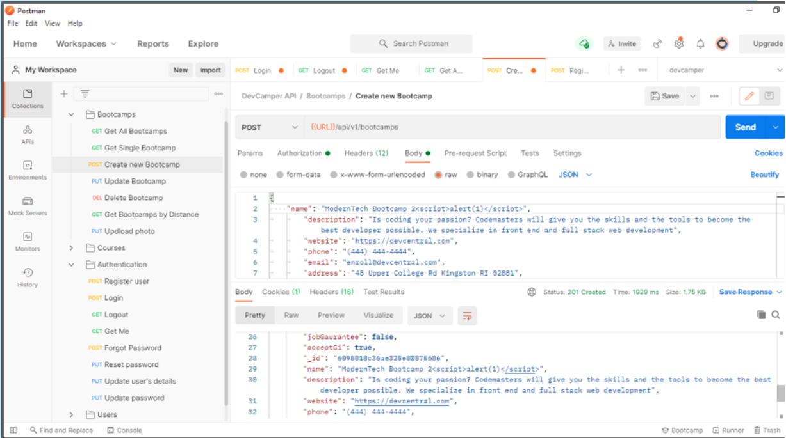
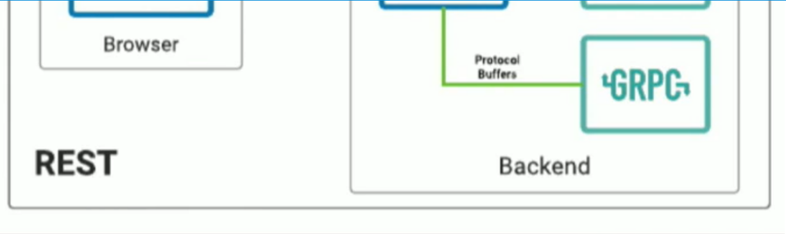

# [Review Question] #3 REST & gRPC

| | |
|---|---|
| **วิชา** | 2110521 Software Architecture (2026/1) |
| **ประเภท** | Review Question (individual) – 11 ข้อ ข้อละ 1 คะแนน |
| **Out / Due** | 7 Oct 2026 → 11 Oct 2026 23:59 |
| **ที่มา** | ถอดจากภาพถ่ายหน้า myCourseVille ใน [rest_grpc/](rest_grpc/) |
| **Slide ที่เกี่ยวข้อง** | **REST API** (Nuengwong Tuaycharoen, 54 slides) → [REST_2023](../materials/lecture_notes/rest/md/REST_2023-336264-16934100818671.md) |
| | **gRPC** (Nuengwong Tuaycharoen, 73 slides) → [gRPC_2026](../materials/lecture_notes/grpc/md/gRPC_2026-336264-17888710746387.md) |

> สัญลักษณ์: **🔘 = ตัวเลือกที่กดส่งไว้** / **✅ = เฉลยที่ควรจะเป็น** (วิเคราะห์เอง ไม่ใช่เฉลยทางการ)
> ข้อที่กดไว้กับเฉลยที่คิดว่าถูก "ไม่ตรงกัน" จะมีป้าย ⚠️ ให้ดูเป็นพิเศษ

---

## ข้อ 1 – XSS ผ่าน POST body

จากรูป เมื่อมีการส่ง POST request และ JSON ด้านบน แล้ว API ส่งข้อมูลกลับมาเป็น JSON ด้านล่าง เป็นปัญหาที่เรียกว่าอะไร

- SQL Injection
- HPP
- CORS
- 🔘 ✅ **XSS**

**เหตุผล:** ฟิลด์ `name` ที่ส่งไปคือ `ModernTech Bootcamp 2` และ server ตอบ 201 Created พร้อมคืนค่าเดิมกลับมาโดยไม่ sanitize ถ้าหน้าเว็บนำค่านี้ไป render จะกลายเป็น Stored XSS (Cross-Site Scripting)

---

## ข้อ 2 – สถาปัตยกรรมของ REST

REST ใช้ใน Architecture แบบใด

- Master-Slave
- Peer-to-Peer
- 🔘 ✅ **Client-Server**
- Layers

**เหตุผล:** Client-Server เป็นหนึ่งใน constraint หลักของ REST (ร่วมกับ Stateless, Cacheable, Uniform Interface, Layered System, Code on Demand)

---

## ข้อ 3 – ชนิดของ gRPC Service Method

ข้อใดไม่ใช่ชนิดของ gRPC Service Method

- 🔘 ✅ **United RPC**
- Bidirectional streaming
- Client streaming
- Server streaming

**เหตุผล:** gRPC มี 4 แบบคือ **Unary** RPC, Server streaming, Client streaming, Bidirectional streaming ไม่มี "United"

---

## ข้อ 4 – Protocol Buffer

ข้อใดกล่าวผิด เกี่ยวกับ Protocol Buffer

- 🔘 ✅ **เขียนขึ้นด้วย Internet Definition Language (IDL)**
- อยู่ในไฟล์นามสกุล `.proto`
- มีหน้าที่อธิบาย service และ message ที่ใช้ระหว่าง gRPC client & server
- เมื่อผ่าน Protoc compiler จะได้เป็น client code และ server code

**เหตุผล:** IDL ย่อมาจาก **Interface** Definition Language ไม่ใช่ Internet

---

## ข้อ 5 – parameter ของ method ฝั่ง Server ⚠️

เมื่อ implement Code ในฝั่ง Server ข้อใดระบุ parameter ให้ method ผิด

- ✅ **Bidirectional streaming: (callback)**
- 🔘 Server streaming: (call)
- Client streaming: (call, callback)
- Unary: (call, callback)

**เหตุผล:** ใน gRPC (Node.js) handler ฝั่ง server รับ parameter ดังนี้

| ชนิด | parameter | เพราะ |
|---|---|---|
| Unary | `(call, callback)` | ตอบกลับครั้งเดียวผ่าน callback |
| Server streaming | `(call)` | ตอบกลับหลายครั้งผ่าน `call.write()` |
| Client streaming | `(call, callback)` | รับหลายครั้งจาก `call.on('data')` แล้วตอบครั้งเดียวผ่าน callback |
| Bidirectional streaming | `(call)` | อ่าน/เขียนผ่าน `call` ทั้งหมด ไม่มี callback |

ดังนั้นตัวที่ผิดคือ **Bidirectional streaming: (callback)** ส่วน Server streaming: (call) ถูกอยู่แล้ว

---

## ข้อ 6 – REST Request Methods

ข้อใดไม่ใช่ REST Request Methods

- POST
- 🔘 ✅ **REMOVE**
- PUT
- GET

**เหตุผล:** HTTP method สำหรับลบคือ `DELETE` ไม่มี `REMOVE`

---

## ข้อ 7 – รูปแบบ request/response ของ REST Server

REST Server รับ request และ response ในรูปแบบใด

- HTTP request (URI + param) / HTTP response (HTML)
- 🔘 ✅ **HTTP request (method + json) / HTTP response (json)**
- HTML request (method + json) / HTML response (json)
- HTML request (URI + param) / HTML response (HTML)

**เหตุผล:** REST ทำงานบน HTTP โดยใช้ method (GET/POST/PUT/DELETE) กับ resource และรับส่งข้อมูลเป็น JSON ส่วน HTML เป็นผลลัพธ์ของ web page ไม่ใช่ REST API

---

## ข้อ 8 – (ตัวคำถามถูกตัดไปในภาพ)

> ⚠️ ภาพถ่ายเห็นเฉพาะส่วนล่างของรูปประกอบและตัวเลือก ไม่เห็นข้อความคำถาม

- Browser
- GRPC
- HTTP
- 🔘 REST API server

**หมายเหตุ:** จาก diagram ฝั่งซ้ายคือ REST (Browser ↔ server) ฝั่งขวาคือ Backend ที่ service คุยกันด้วย Protocol Buffers ผ่าน gRPC ซึ่งสอดคล้องกับตัวเลือก "REST API server" ถ้าคำถามถามถึงส่วนที่อยู่ระหว่าง Browser กับ Backend

---

## ข้อ 9 – HTTP Status Code

Response Status Code ใดให้ความหมายผิด

- 🔘 ✅ **400 Unauthorized**
- 500 Internal Server Error
- 404 Not Found
- 200 Success

**เหตุผล:** 400 คือ **Bad Request** ส่วน Unauthorized คือ **401**

---

## ข้อ 10 – ข้อใดกล่าวผิดเกี่ยวกับ gRPC ⚠️

ข้อใดกล่าวผิดเกี่ยวกับ gRPC

- client และ server ของ gRPC สามารถเขียนขึ้นด้วยภาษาที่ต่างกันก็ได้
- ✅ **client ของ gRPC คือ web browser**
- stub ทำหน้าที่ให้บริการ method ที่อยู่บน server ให้กับ client
- 🔘 client และ server ของ gRPC สื่อสารกันผ่าน Proto Request/Proto Response

**เหตุผล:**
- gRPC เป็น language-agnostic เขียน client/server คนละภาษาได้ ✔
- stub คือ proxy ฝั่ง client ที่ทำให้เรียก method บน server ได้เหมือน local ✔
- client และ server รับส่ง message ที่นิยามใน `.proto` (Proto Request/Response) ✔
- **web browser ไม่สามารถเป็น gRPC client โดยตรง** เพราะ browser ไม่ได้ expose HTTP/2 framing/trailers ให้ JS ใช้ ต้องผ่าน gRPC-Web + proxy (เช่น Envoy) → ข้อนี้คือข้อที่ผิด

---

## ข้อ 11 – การเรียก REST API ที่ผิด

การเรียกใช้ REST API ในข้อใดผิด

- 🔘 ✅ **POST http://localhost:5000/subscribers/609bd8671452242d88d36e36**
- DELETE http://localhost:5000/subscribers/609bd8671452242d88d36e36
- GET http://localhost:5000/subscribers
- GET http://localhost:5000/subscribers/609bd8671452242d88d36e36

**เหตุผล:** POST ใช้สร้าง resource ใหม่จึงต้องยิงไปที่ collection (`/subscribers`) โดย server เป็นคนกำหนด id ส่วน GET/DELETE/PUT ค่อยระบุ id ของ resource นั้น

---

## สรุปคำตอบ

| ข้อ | หัวข้อ | กดส่งไว้ | เฉลย (วิเคราะห์) | ผล |
|---|---|---|---|---|
| 1 | ช่องโหว่จาก POST body | XSS | XSS | ✅ |
| 2 | Architecture ของ REST | Client-Server | Client-Server | ✅ |
| 3 | ชนิด gRPC method | United RPC | United RPC | ✅ |
| 4 | Protocol Buffer | Internet Definition Language | Internet Definition Language | ✅ |
| 5 | parameter ฝั่ง server | Server streaming: (call) | Bidirectional streaming: (callback) | ⚠️ |
| 6 | REST method | REMOVE | REMOVE | ✅ |
| 7 | request/response ของ REST | HTTP (method+json)/HTTP (json) | HTTP (method+json)/HTTP (json) | ✅ |
| 8 | (คำถามไม่ครบ) | REST API server | – | ❓ |
| 9 | Status code | 400 Unauthorized | 400 Unauthorized | ✅ |
| 10 | ข้อผิดเกี่ยวกับ gRPC | Proto Request/Proto Response | client ของ gRPC คือ web browser | ⚠️ |
| 11 | การเรียก REST ที่ผิด | POST …/subscribers/{id} | POST …/subscribers/{id} | ✅ |

---

## Cheat sheet สั้น ๆ

**REST**
- Architecture: Client-Server, Stateless, Cacheable, Uniform Interface, Layered, (Code on Demand)
- Method: GET (อ่าน) / POST (สร้าง → ยิงที่ collection) / PUT, PATCH (แก้ → ระบุ id) / DELETE (ลบ → ระบุ id)
- Status: 200 OK, 201 Created, 400 Bad Request, 401 Unauthorized, 403 Forbidden, 404 Not Found, 500 Internal Server Error
- ช่องโหว่ที่เจอบ่อย: XSS (script ใน input), SQL Injection, HPP (HTTP Parameter Pollution), CORS misconfiguration

**gRPC**
- นิยาม service/message ใน `.proto` ด้วย IDL (**Interface** Definition Language) → `protoc` generate client stub + server skeleton
- สื่อสารด้วย Protocol Buffers (binary) บน HTTP/2 → client/server คนละภาษาได้
- 4 ชนิด method: Unary, Server streaming, Client streaming, Bidirectional streaming
- server handler (Node): Unary `(call, callback)` / Server stream `(call)` / Client stream `(call, callback)` / Bidi `(call)`
- browser เรียก gRPC ตรง ๆ ไม่ได้ ต้องใช้ gRPC-Web ผ่าน proxy
